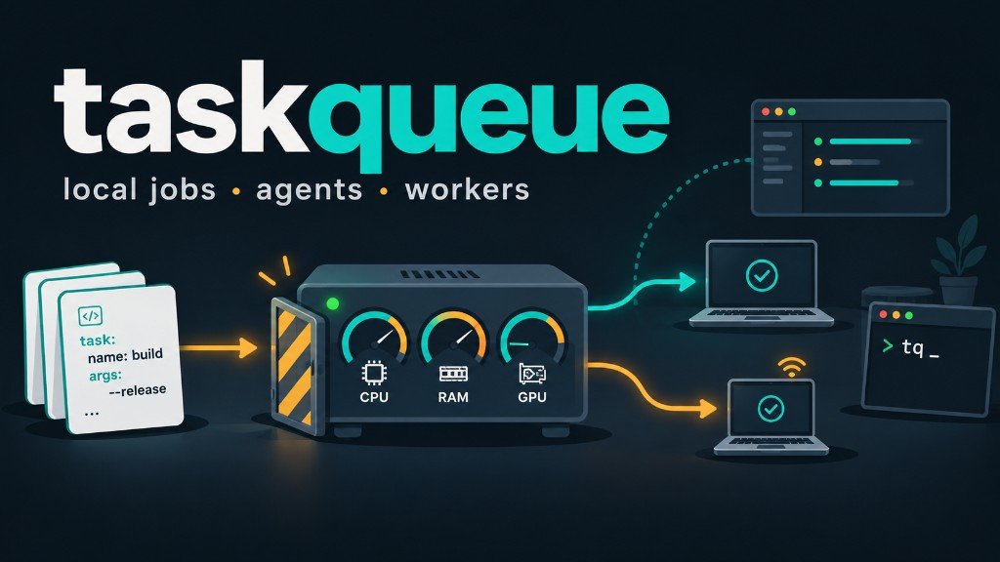

# taskqueue

[English](README.md) | [Polski](README.pl.md) | [中文](README.zh.md) | [العربية](README.ar.md)

[](LICENSE)
[](https://www.python.org/downloads/)
[](https://github.com/wwylon/taskqueue)



**taskqueue** uruchamia długie zadaniaania na Twoich komputerach, nie przeciążając
ich. Opisujesz job w YAML. Lokalny **daemon** startuje pracę tylko gdy jest
wystarczająco CPU, RAM i pamięci GPU. Postęp śledzisz w **UI**, CLI **`tq`**
lub przez agenta AI (**MCP**).

To nie Celery, Kubernetes ani CI. To też nie stary projekt AMQP/Debian
[rojkov/taskqueue](https://github.com/rojkov/taskqueue) (simpletaskqueue).

## Po co

- Przyjmowanie zadań według zasobów (CPU / RAM / GPU) lokalnie lub na workerach
- YAML: checkpointy, zależności, priorytety, stabilne kody błędów
- Pod agentów: submit / wait / diagnose przez MCP
- Lokalnie — bez konta w chmurze SaaS

## Najlepszy start: poproś agenta

Powiedz agentowi (Cursor, Claude Code, …), żeby używał **taskqueue** do długich
jobów: MCP (`tq mcp`), YAML i `wait_for_task` zamiast blokować czat.
Setup: **[docs/mcp.md](docs/mcp.md)**.

## Instalacja

**Wymagania:** Python **3.12+**, [Git](https://git-scm.com/), [`uv`](https://docs.astral.sh/uv/).

```powershell
git clone https://github.com/wwylon/taskqueue.git
cd taskqueue
uv sync
uv run tq doctor
uv run tq start
```

Otwórz **http://127.0.0.1:8765**. Przykład:
[`examples/minimal`](examples/minimal/).

## Dokumentacja

| Dla | Start |
|-----|--------|
| Ludzie | [docs/README.md](docs/README.md) · [Quickstart](docs/operators/quickstart.md) · [Web UI](docs/operators/web-ui.md) · [CLI](docs/operators/cli.md) |
| Agenci | [AGENTS.md](AGENTS.md) · [MCP](docs/mcp.md) · [Cookbook](docs/agents/task-script-cookbook.md) · [llms.txt](llms.txt) |

**Zaawansowane:** [Security](docs/security.md) · [Task standards](docs/task_standards.md) · [Scheduler](docs/scheduler.md) · [Workers](docs/WORKER_SETUP.md)

## Przejrzystość

Nie wysyłamy telemetrii. Publiczne sygnały: gwiazdki GitHub; po publikacji na
PyPI — liczniki pobrań. Szczegóły: [docs/security.md](docs/security.md#privacy--telemetry).

## Licencja

MIT — [LICENSE](LICENSE) · [Changelog](CHANGELOG.md)
