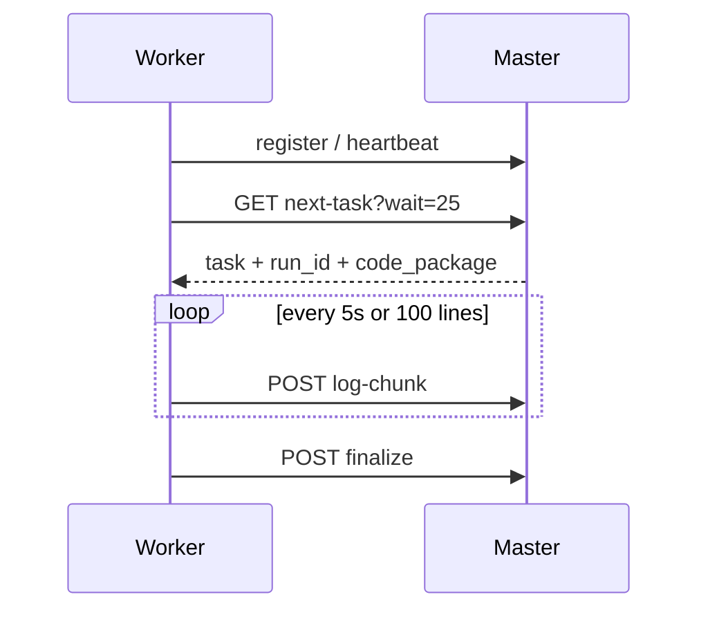
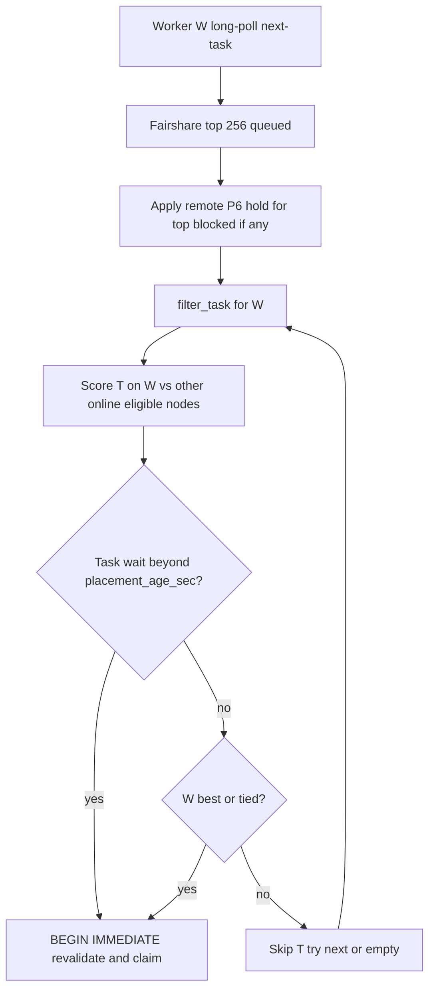
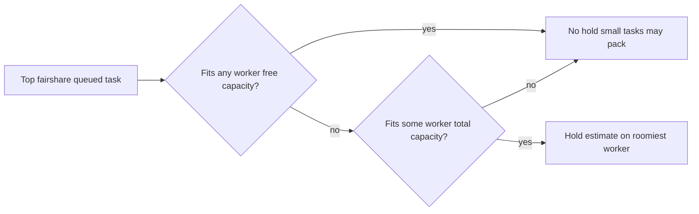

# Master–worker architecture

Reference for how remote workers claim tasks, synchronize code and files, stream logs, and recover from disconnects.

**Configure (simple steps + full reference):** [WORKER_SETUP.md](WORKER_SETUP.md) — start with **Quick start — step by step**.  
YAML fields: [task_standards.md](task_standards.md) §4. Errors: [errors.md](errors.md). State home: default `~/.taskqueue` (port **8765**).

---

## Pull model

Workers **initiate** all HTTP to the master. The master never pushes assignments to worker sockets.

1. Worker registers and heartbeats (`POST /api/worker/register`, `/api/worker/heartbeat`).
2. Worker long-polls `GET /api/worker/next-task?wait=` (up to 30s) when idle.
3. Master atomically claims one queued task (`BEGIN IMMEDIATE` in SQLite).
4. Worker downloads code/transfer/data artifacts, runs in an isolated workspace, streams logs, finalizes.

The daemon tick runs a **parallel local path** (`_local_admit_queued`) for tasks that may run on the master.

---

## Who runs what (`dispatch`)

| `dispatch` | Online workers > 0 | Runs on |
|------------|-------------------|---------|
| `local` (default) | any | Master only |
| `remote` | yes | Worker (master blocked) |
| `remote` | no | Master fallback |
| `any` | any | Best-fit claim among workers, or local admit |

**Conventions:** WSL/build pipelines → `local`. GPU overnight → `remote` or `any`. Do **not** use `remote` to park work when no workers exist.

---

## Synchronization

| Mechanism | When | Remote only? |
|-----------|------|--------------|
| `code.provider: git_patch` | Claim: master captures HEAD + dirty overlay; worker downloads if cache miss | Yes |
| `code.provider: bundle` | Claim: worker downloads tarball to per-attempt workspace | Yes |
| `transfer` push | Before spawn: master → worker | Yes |
| `transfer` pull | After exit: worker → master project root | Yes |
| `data/` manifest | Before every remote task (mtime/size diff) | Yes |
| Logs (`log-chunk`) | During run: every 5s or 100 lines | Yes (local writes direct to disk) |

Workers materialize code under `{home}/cache/code/<hash>/` and a writable copy under `{home}/runs/<run_id>/work`. Bundles **do not** unpack onto shared `project.root`.

---

## Logs

- **During run:** incremental `POST /api/worker/log-chunk` appends to the master's log file. Each chunk carries a monotonic `seq`; a retried POST with an already-accepted `seq` is acknowledged (`duplicate: true`) without appending the text twice. CAS blob uploads (`/api/data/push/...`) with a body shorter than `Content-Length` are rejected (400) and nothing is stored.
- **Not at finalize:** logs are not bulk-copied; only `transfer` pull and default `reports/` / `experiments/ledger/` uploads run post-exit.
- **On demand:** `GET /api/logs/<run_id>`, SSE stream, `tq diagnose`, MCP `log_tail`.
- **Limits:** tail reads capped at 8 MiB; log-chunk JSON body capped at 1 MiB; on-disk log files have no cap.

---

## Disconnection and recovery

| Event | Result |
|-------|--------|
| Heartbeat stops | Lease expires (~90s); reclaim → `queued` (idempotent) or `unknown` (non-idempotent / `at_most_once`) |
| Worker partition (R-012) | Worker stops child ~15s before lease expiry if heartbeats fail |
| Finalize network fail | `{home}/pending_finalize/{run_id}.json` outbox; worker retries before new claims |
| Late finalize after reclaim | Rejected (`run not running`, token/session mismatch) |
| Worker restart | New `session_id`; old session cannot finalize |
| Hung remote (worker online, no progress K ticks) | Idempotent → re-queue; `at_most_once` → `unknown` after 3×K ticks |
| Wall-clock cap exceeded | Worker terminates; finalize with `status=interrupted`, `stop_reason=wall_clock_cap`, `last_error_code=tq.run.cap`. Opt-in YAML `auto_retry_on_cap` re-queues on master (same as local) |

Error codes: `tq.infra.worker_lost`, `tq.infra.lease_expired_worker_alive`, `tq.infra.hung`, `tq.run.cap`. See [errors.md](errors.md).

---

## Many workers

Workers still **pull** via `GET /api/worker/next-task`; the master does not push assignments.

With default `placement_mode=binpack`, a worker only claims a task if it is a **best-fit**
(or tied) among fresh online eligible peers — leftover RAM (and VRAM when the task needs
GPU) after placement. A quieter roomier worker wins over a tight poller. Ties keep
first-claim-wins (T-031).

Anti-starvation: if a task has waited ≥ `placement_age_sec` (default 120), any feasible
worker may claim it. Stale peers (`worker_health` ≠ online) are ignored. Set
`placement_mode=first_fit` for the legacy “first feasible claim” behavior.
`placement_shadow_mode=1` logs would-skip decisions without enforcing.
With `placement_prefer_last_worker=1` (default), equal scores prefer the task’s
last `worker_id` (soft sticky — never migrates a running job).

When the top fairshare queued task fits no worker’s **free** capacity but fits some
worker’s **total**, a remote P6 hold reserves its estimate on the roomiest worker
(same `reservation_max_ticks` × `scheduler_interval_sec` budget as local P6) so small
tasks cannot drain that headroom. This does **not** set YAML `exclusive`.

Multi-slot: one worker may hold multiple tasks until declared RAM/CPU/VRAM is exhausted
(heartbeat live load reduces leftover capacity).

See [scheduler.md](scheduler.md) for admission and remote scoring.

---

## Large payloads (current limits)

- Upload (`transfer/put`, `data/upload`): **64 MiB** max.
- Download (package, bundle, transfer get): **unbounded**; entire file loaded into memory — do not use for multi-GB artifacts yet.

---

## Local vs remote admission asymmetry

| | Local master | Remote worker |
|--|--------------|---------------|
| Resource estimate | History/sibling/group + declared max | Same `estimate_task_resources` on claim |
| Host gates | Soft/hard RAM, anti-flap, unknown cap | Worker slot + heartbeat load + best-fit / remote P6 |
| `dispatch: remote` | Blocked when workers online | Preferred target |

See [scheduler.md](scheduler.md).

---

## Known limitations

- Master migration / `leader_epoch` (I3) not fully closed — `tq master-migrate` exists; worker `master_url` redirect still later.
- `dry_run: true` sets `TQ_DRY_RUN=1` but is **not** filtered at claim/admit time (documented mismatch).
- `remote-only-if-busy`: prefer remote when the local host already has running work and workers are online; otherwise run locally (F-125).
- log-chunk and transfer routes do not require `master_lease` (HA edge case).

---

## Triage cheat sheet

| Symptom | Check | Action |
|---------|-------|--------|
| Task stays queued, `dispatch: remote` | `tq worker list` | Start worker or change to `local`/`any` |
| Task `unknown` | `tq diagnose proj/task` | Manual `tq retry` — never auto-restarted |
| No log before task ends | Remote run? | Logs stream during run; refresh UI / `tq logs` |
| Worker shows offline | `last_seen`, network | Restart worker; check Tailscale/token |
| Duplicate runs | `SELECT COUNT(*) FROM runs` | Should not happen (atomic claim); report bug |

**Verify:** `tq worker list`, `tq capacity`, `tq doctor`, `tq diagnose <project/task>`.

---

## Appendix A — live soak checklist

Run against the default home (`~/.taskqueue`, port **8765**). Confirm with `tq doctor` before pointing a worker at a master.

1. `tq sync` with `fixtures/tqdemo` registered; enqueue `mw-dispatch-*` YAMLs.
2. Confirm `dispatch: remote` runs on worker-B; `local` stays on master.
3. Kill worker mid `mw-idempotent-reclaim` → task returns to `queued`.
4. Kill network before finalize → restart worker → pending-finalize delivers.
5. Queue 10 tasks, 2 workers → exactly 10 runs, no duplicates.
6. Two workers with uneven free RAM (`placement_mode=binpack`) → a large task is claimed by the roomier worker; set `placement_mode=first_fit` to confirm legacy behavior.
7. Remote P6: fat top task that only fits one worker’s total capacity → small fillers on that worker stay queued while the hold is active.
8. `mw-transfer-roundtrip` with `input/seed.txt` on master.
9. `mw-biglog` — confirm log lines visible on master before finalize (`tq logs` or UI).

Automated coverage: `tests/test_mw_*.py` (30 cases), `tests/test_placement_best_fit.py`.
