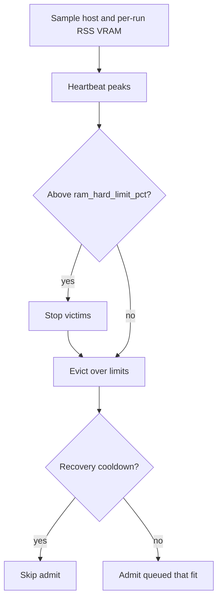
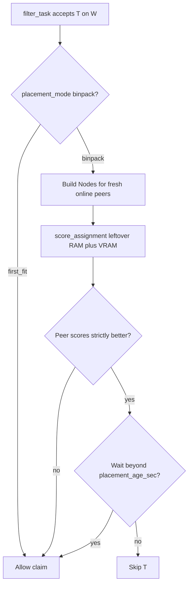
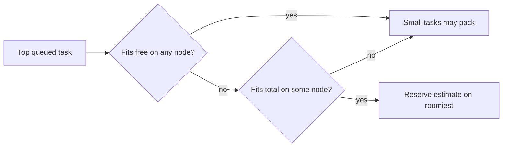

# How the scheduler works

Reference for the local admission-control path: how the daemon decides what to
start, what to stop, and how it estimates what a task will cost.

Field reference for what a YAML may declare: [`task_standards.md`](task_standards.md).

**Master–worker:** local admission (this doc) and remote worker claims share `filter_task()` in `taskqueue/scheduler.py`. Remote workers pull via `GET /api/worker/next-task`. With `placement_mode=binpack` (default), claim is gated by best-fit among online peers (see §3 Remote scoring). Full reference: [master_worker.md](master_worker.md).

---

## 1. The tick loop

The master runs two scheduling paths:

### Full tick (every `scheduler_interval_sec`, default 5s)

Actual order in `daemon_tick` (doc aligned to code, Round 11):

1. **Lease / clock** — renew or reclaim master lease; clock-jump recovery.
2. **Sync** — YAML reconcile (`_sync_project`).
3. **Sample** — refresh host CPU/RAM, and per-run RSS for every active run (fast `psutil`; no `nvidia-smi` on this path).
4. **Hung / stops / reap** — hung-remote checks, stop requests and wall-clock caps, detect finished local subprocesses, finalize DB state.
5. **Heartbeat** (every `heartbeat_sec`) — VRAM probe + peak updates when due.
6. **Hard-RAM / VRAM relief** — if host RAM or device VRAM is above hard limits, stop tasks until the projection falls under the soft limit (§4).
7. **Evict** — drop runs that no longer fit a lowered limit or an exceeded `max_concurrent_tasks`.
8. **Cancel deps / scavenger / Admit** — cancel dead/negative dependents, preempt scavengers, then start queued tasks that fit (§3). Dependency peers must all be `completed` (`filter_deps`); resume from checkpoint uses the same gate.

Admission is skipped entirely while a recovery cooldown is active (§4).

**Running tasks and deps:** each tick re-checks `depends_on` for every `running` task. If an upstream was re-queued (or otherwise left `completed`) while a dependent was still executing, the dependent is cooperatively stopped with `tq.stop.deps` → status `stopped` (auto-restartable). The next admit waits until peers complete again, then may use `resume_args`.

Between full ticks the daemon sleeps up to `scheduler_interval_sec`, but **wakes immediately** when a local subprocess exits (§1.1), and also when work is **enqueued** via `tq retry` / force / YAML sync (`wake_scheduler` in `sched_wake.py`). On an early wake, if a sync is pending (`_sync_requested`), the daemon runs sync before admit so newly written YAMLs are visible in the same pass.

### Fast path (on local subprocess exit)

When any local `ActiveRun` finishes, the reader thread signals `sched_wake` (`taskqueue/sched_wake.py`). If the daemon is sleeping between ticks, it runs a **minimal pass** instead of waiting for the next full tick:

1. **Reap** — same logic as step 2 above.
2. **Admit** — same gates as the full tick (`recovery_cooldown`, CPU soft gate, `ResourceBudget`, `admit_max_per_tick`, …). Optionally sync first when `_sync_requested`.

It does **not** re-run heartbeat or pressure relief on every wake. Safety gates inside `_local_admit_queued` still apply; `force_run` and recovery cooldown behaviour are unchanged.

Typical handoff when resource gates pass: **under ~1s** from process exit to `>> started` for the next queued task. The full tick interval is only the fallback when nothing is finishing during the sleep window.

### 1.1 Finalize and handoff diagnostics

On exit the local runner:

- Flushes cached progress/peaks to the DB (**without** a finalize-time `nvidia-smi` probe).
- Atomically updates `runs` + `tasks` in one transaction (`finalize_run_and_task`).
- Runs `on_complete` / `on_fail` / `rearm_on` hooks synchronously (re-queue dependents).
- Runs `teardown` in a **background thread** so a slow shell hook cannot stall admission.
- Fires opt-in `notify_url` webhooks asynchronously (unchanged).

**Measure handoff in logs:**

```powershell
tq log --grep ">> started|-> completed|admission frozen|admission skipped"
```

| Log pattern | Likely cause |
|---|---|
| Gap ≈ `scheduler_interval_sec` only on an **old** daemon | Upgrade/restart — fast path missing |
| `admission frozen for Ns after resource-pressure stop` | `recovery_cooldown_sec` after RAM/VRAM kill (intentional) |
| `RAM: prior peak/hint … would exceed hard limit` | Anti-flap; OS has not reclaimed RSS yet |
| `hold … reserved for proj/task` | P6 headroom reservation for top blocked task |
| Long gap with no block lines, task has `teardown:` | Pre-async-teardown daemon, or teardown still running while **next** task waits on RAM |

Optional tighter fallback poll (in addition to fast path):

```powershell
tq config set scheduler_interval_sec=2
```

Min is `1`. Do not set `recovery_cooldown_sec=0` unless you accept admitting into unreclaimed RAM after a pressure stop.



## 2. Estimating what a task will cost

Declared `resources:` are a *hint*, not the truth — the common failure is a task
that declares nothing, or declares far less than it uses. `taskqueue/estimate.py`
resolves an estimate for every candidate, taking the **maximum** of the declared
value and the predicted one, floored at `default_task_ram_gib`.

Prediction walks the first source that has data:

| Source | Basis |
|---|---|
| `history` | p95 of `peak_ram_gib` / `peak_vram_gib` over the task's own last `resource_predict_runs` runs (default 5) |
| `sibling` | runs of other tasks sharing the same `yaml_source` |
| `group` | runs of other tasks sharing the same `grp` |
| `default` | `default_task_ram_gib` floor; VRAM 0 |

**Why `sibling` matters.** A `matrix:` block expands one YAML into N tasks
(`job_seed0` … `job_seed4`) that all share a `yaml_source`. They are the same
program with a different flag, so once `job_seed0` has run, its measured peak is
the best available estimate for every sibling — without this they would all be
zero-history guesses admitted together, which is exactly the shape of the
incident that produced this design.

An estimate resolving to `default` with no declared VRAM is flagged **unknown**
— the scheduler genuinely does not know what this task will do (§3).

## 3. Admission

Queued tasks are ranked (`sort_queued_fairshare` in `resources.py`), then the
same **Filter → Score → Reserve → Assign** path in `taskqueue/scheduler.py`
runs against a `Node`: `master-local` for the daemon, or a worker row for
`claim_next_remote_task`. Hard filters (project, OS/arch/tags, RAM, per-GPU
VRAM, deps, exclusive / exclusive_project, freeze/pause, global/project limits) are shared.
The local tick still uses `ResourceBudget` (live host RAM, estimates, antiflap)
after those filters pass. Remote leftover RAM comes from running-on-this-worker
reservations plus heartbeat `load` (R-008). Claim path also uses
`estimate_task_resources` (same sources as local).

**Exclusive drain.** When the top runnable task is `exclusive` (or `exclusive_project`)
and others are still running, no other task (of that project, for `exclusive_project`) is
admitted until it has started. Without the drain, a steady supply of small tasks would keep
the host busy forever and the exclusive task would starve. Blocked tasks show
`draining for exclusive task <key>`; `force_run` bypasses it.

**Candidate window.** Both paths look at the top `admit_candidate_window` (default 256)
queued rows by priority. When that window is full, up to the same number of *further*
rows are appended if their dependencies are met and their project is not frozen or paused,
so a block of blocked high-priority tasks cannot hide runnable lower-priority ones.

### Remote scoring (PC-1)

After a worker passes `filter_task` for candidate T, `score_assignment` compares
leftover RAM (and VRAM when needed) against other **fresh online** eligible
workers. If another peer scores strictly better, the claim is skipped unless
the task is aged (`placement_age_sec`) or `placement_mode=first_fit`.
See [master_worker.md](master_worker.md) “Many workers”.



### Remote P6 hold (PC-2)

If the top fairshare queued task fits no worker’s free capacity but fits some
worker’s total, its estimate is held on the roomiest worker so small tasks
cannot drain that headroom (`reservation_max_ticks` × `scheduler_interval_sec`).
Does not set YAML `exclusive`. Full Slurm-style backfill remains a later gap (§7).



For each queued candidate, in priority order:

- **Estimate** resources as above.
- **Unknown cap** — if `max_concurrent_unknown` (default 1) tasks with unknown
  cost (no RAM/VRAM declaration and no history/sibling/group signal) are already
  running, no further unknown task is admitted. The first zero-history undeclared
  task runs alone and *produces* the history its siblings inherit. A declared
  `ram_gib` below `default_task_ram_gib` still counts as known — the floor may
  raise the numeric estimate without consuming this slot.
- **Fit** — `ResourceBudget.fits()` checks the estimate against CPU, per-device
  VRAM, and host RAM. A failed `nvidia-smi` does **not** become “this machine
  has 0 GiB VRAM”: the daemon keeps the last successful GPU inventory (and a
  short grace if the tool briefly reports zero devices). Admission then says
  `GPU: probe failed: …` instead of `limit is 0.0`.
- **Reserve and start**, then stop after `admit_max_per_tick` (default 1)
  admissions this tick. `admit_settle_sec` optionally sleeps and re-samples
  between admissions.

### Scavenger tasks (`class: scavenger`)

Filler work (extra seeds, wider arms) that must never delay real work.

- **Admission:** scavengers are judged *after* all normal candidates in a tick.
  If any non-scavenger task was refused for capacity (`tq.block.resources`: global
  or per-project caps, CPU/RAM/VRAM) this tick, scavengers wait with
  `tq.block.scavenger`. Blocks on deps, pause, freeze or services are not
  contention. `force_run` bypasses.
- **Preemption:** each tick, if a scavenger is running and a non-scavenger task is
  queued with a recorded `tq.block.resources` (excluding `project …` own-cap
  blocks), one scavenger is cooperatively suspended (control file →
  `suspend_grace_sec` → SIGTERM). At most one per `scavenger_preempt_cooldown_sec`
  (default 60) and none while a previous victim is still stopping.
- **Resume:** the run ends `stopped` / `tq.stop.scavenger` (exit 75 is *not*
  recorded as `suspended`) and is re-queued automatically, using `resume_args`.
- **v1 limits:** local daemon only — remote workers do not apply the class gate
  or preempt.

### Per-project minimum slots (`min_tasks`)

With a global `max_running_tasks`, a project may set `min_tasks` (Config page / `/api/project-limits`). While that project has queued work and fewer than `min_tasks` running, *other* projects' tasks are refused once `running + unmet minimums >= max_running_tasks` (`block_reason`: "slots reserved for other projects' min_tasks"). An idle project reserves nothing; `force_run` bypasses; the timeline forecast ignores minimums.

### VRAM admission: declared vs live

Declared `resources.gpu_vram_gib` is **not** summed against physical VRAM for
tasks that are already running:

- **Running local tasks** are charged at *live measured* device usage
  (`ResourceBudget` seeds `gpu_reserved` from `gpu_live`).
- **The candidate** is charged its *estimate* (declared, or the larger history
  p95; see the estimate table above). It is admitted iff
  `live + estimate <= gpu_limit` **and** some single device has `estimate` free.
  Same-tick admissions add their estimate on top.
- So declared VRAM may exceed physical VRAM when real use is low: three running
  tasks that declare 4.0 GiB but use ~0.4 GiB each leave room for a 0.5 GiB task,
  and a 4.0 GiB candidate is refused once live use leaves less than 4.0 GiB.
- `tq capacity` → `vram_gib_reserved` is only the *informational* sum of declared
  values over running local tasks. It can exceed `vram_gib_total` and does not
  gate admission; `vram_gib_free` (limit minus live/reserved) is what admission
  uses.
- A candidate whose estimate exceeds total VRAM never runs on this machine
  (`tq.block.vram_exceeds_system`). Remote workers use `max(live, declared)`
  per worker when computing free capacity.
- Declare measured values: under-declaring a task that later spikes is caught
  only by the hard VRAM stop (`vram_hard_limit_pct`, see Limitations).

### The RAM gate is additive

`ram_reserved` is seeded each tick from live whole-host used RAM, then topped up
by same-tick reservations. The gate is:

```
ram_reserved + estimate > ram_limit   ->  refuse
```

It asks *"will this task put the host over?"*, not *"is the host already
over?"*. The latter always overshoots by at least one task, since nothing is
over-limit until after the task that pushed it there has started.

### Unsettled reservation

A task that has been running for less than `settle_window_sec` (default 180s)
has not yet reached its peak — it may still be loading model weights. For those,
the scheduler reserves `estimate − current_rss` on top of the live host reading,
so memory that is about to be consumed is not treated as free.

The live host sample already includes the task's current usage, so only the
*difference* is added; adding the full estimate would double-count it.

### Fail closed

If host RAM cannot be read at all, `ResourceBudget` records
`measurement_failed` and `fits()` refuses everything. Admitting blind is how a
host gets wedged.

### Shadow mode

`tq config set admission_shadow_mode=1` logs every decision as
`SHADOW would-block` without enforcing (see `{home}/daemon.log` via
`tq log --grep SHADOW`). Use it for one night on a real
workload before enabling enforcement, and diff intent against what actually ran.

`tq force <project/task_id>` bypasses the gates; the daemon logs a WARN naming
the gate that was overridden.

## 4. Stopping under pressure

Above `ram_hard_limit_pct` the daemon stops tasks in a loop until the projected
host usage falls under the soft limit, capped at `stop_max_per_tick` (default 2)
per tick so one spike does not clear the whole queue. Each stop reduces the
projection by that task's measured RSS, so it stops as few tasks as will do.
Stops reap the **full process tree** (short grace, then kill) so a `cmd /c`
wrapper cannot leave Python holding RSS after `tq.stop.ram`.

Afterwards admission freezes for `recovery_cooldown_sec` (default 30s). Freed
memory is not returned to the OS instantly; admitting into it immediately is how
a stop cascade starts.

## 4b. Wall-clock cap (not RAM eviction)

When `wall_clock_cap_sec` expires, the daemon (or remote worker) stops the run
with `stop_reason=wall_clock_cap`. Finalize records:

| Outcome | Task status | `last_error_code` | Auto-restart? |
|---------|-------------|-------------------|---------------|
| Cap kill | `interrupted` | `tq.run.cap` | Only if YAML `auto_retry_on_cap: true` and semantics are `checkpointable` / `idempotent` (see [`task_standards.md`](task_standards.md)) |
| Real non-zero exit | `failed` | `tq.run.nonzero` | No (unless you `tq retry` / `max_attempts` policy) |
| RAM hard eviction | `stopped` | `tq.stop.ram` | Yes — `stopped` is admitted like `queued` when soft pressure clears |
| VRAM hard eviction | `stopped` | `tq.stop.vram` | Yes — same auto-restart path as RAM hard stops |

Cap auto-retry immediately sets `status=queued` and increments `cap_auto_retry_count`
(shown in `tq list` as `cap×N/M`). It does **not** use the `stopped` / RAM path.
Manual `tq retry` (including `--project` / multi-ID batch) resets the counter.

### Which task gets stopped

Runs that already carry a `stop_reason` (a stop is in flight) are never re-picked: they
are left out of the candidate list and their current RAM/VRAM counts as relief already
on the way, so a dying victim does not consume the per-tick `stop_max_per_tick` budget.

All three stop paths — hard-RAM relief, limit-drop eviction, and
`max_concurrent_tasks` excess — share `taskqueue/victim.py`. Each candidate is
scored on the **cost of killing it**, lowest wins:

```
+ 1.5 * progress_pct/100        work destroyed
+ 1.0 * priority/100            operator-declared importance
+ 0.5 * min(1, elapsed/1h)      long uncheckpointed runs are expensive to redo
- 1.0 * restartability          cheap to kill if it can just be re-run
- 2.0 * relief                  how much pressure this actually removes
```

**Restartability** is `1.0` for `idempotent: true`, `0.6` for a task that can
resume (declares `resume_args`, or its last run ended
`interrupted`/`suspended`/`stopped`), `0` otherwise.

Relief carries the largest weight deliberately: a critical host must actually
recover, so a task that frees nothing is never chosen merely for being
restartable. Among candidates that relieve comparable pressure, restartability
and lost work decide — which means a 5 GiB job at 90% with no checkpoint is now
preserved over a 4 GiB idempotent one at 10%, the reverse of the old
biggest-RSS-wins rule.

The runner-up is logged with every stop; without it an operator cannot tell a
good decision from a lucky one.

## 5. Config keys

| Key | Default | Meaning |
|---|---|---|
| `scheduler_interval_sec` | `5` | Full tick period and max sleep between ticks. Handoff after local exit is usually much faster via the fast path (§1). |
| `ram_limit_pct` | `80` | Soft gate; admission stops above it. |
| `ram_hard_limit_pct` | `95` | Hard gate; tasks are stopped above it. Must be ≥ soft. |
| `max_concurrent_tasks` | `0` | Cap on local running tasks; `0` = unlimited. |
| `default_task_ram_gib` | `1.0` | Floor estimate for a task with no history and no declaration. |
| `resource_predict_runs` | `5` | Runs sampled for the p95 prediction. |
| `admit_max_per_tick` | `1` | Admissions per tick — the stagger. |
| `admit_settle_sec` | `0.0` | Sleep + re-sample between admissions. |
| `max_concurrent_unknown` | `1` | Concurrent tasks with unknown cost. |
| `settle_window_sec` | `180` | How long a run is treated as not yet at peak. |
| `stop_max_per_tick` | `2` | Stops per tick under hard pressure. |
| `recovery_cooldown_sec` | `30` | Admission freeze after a pressure stop. |
| `admission_shadow_mode` | `0` | `1` logs decisions without enforcing. |
| `placement_mode` | `binpack` | Remote claim: `binpack` (best-fit among peers) or `first_fit` (legacy). |
| `placement_age_sec` | `120` | Wait before best-fit may be bypassed (0 = always aged). |
| `placement_shadow_mode` | `0` | `1` logs would-skip placement without enforcing. |
| `placement_prefer_last_worker` | `1` | Soft sticky: on equal score, prefer last run’s worker. |
| `reservation_max_ticks` | `60` | Local + remote P6 headroom hold budget (× `scheduler_interval_sec`). |
| `gpu_util_warn_pct` | `15` | Heartbeat WARN threshold: GPU util EMA below this % after settle window triggers a pipeline-bottleneck warning in daemon.log. |
| `ram_settle_sec` | `1800` | How long to wait before RSS trend detection activates (default 30 min). Separate from `settle_window_sec` (GPU settle) because initial ramp-up and multi-stage shard rotations are legitimately large; 30 min gives the OLS window time to average out shard load/free cycles. |
| `ram_leak_warn_gib_per_hour` | `1.0` | Heartbeat WARN threshold: if OLS slope over the 10-min RSS window exceeds this value after `ram_settle_sec`, a memory-growth warning is emitted. Set higher for tasks with known large mmap pre-loads; set to `0` to disable. |
| `clock_jump_threshold_sec` | `0` | Wall-clock gap that counts as sleep/wake (F-001). `0` = auto `max(2×scheduler_interval, 30)`. Raise on laptops if lid-close kills tasks too aggressively. |
| `clock_jump_max_requeue` | `3` | After this many clock-jump interrupts per task in the window, leave the task **interrupted** instead of auto-requeueing. `0` = unlimited (anti-flap disabled). |
| `clock_jump_requeue_window_sec` | `3600` | Rolling window for `clock_jump_max_requeue`. |

The gap is measured from the start of the scheduler's idle wait, so a slow tick (slow probes, a 30 s graceful stop) is never mistaken for a host sleep and does not requeue healthy runs.

When a clock-jump flap triggers, the task gets `tq.infra.clock_jump_flap` — use `tq retry` once the host is stable.

## 6. Memory management — operator guide

### Why everything is blocked even though no tq task is running

`ram_live` is seeded from `psutil.virtual_memory().used` — **whole-host used RAM**,
not just tq-owned processes. A process started outside tq (e.g. a manual training
run, a Jupyter kernel, another project's training job) counts against the budget
exactly as if tq had started it. This is by design: the host has one RAM pool.

**Diagnosis — which process is using the memory?**

```powershell
# Windows: list processes >500 MB sorted by RSS
Get-Process | Where-Object WorkingSet64 -gt 500MB |
  Sort-Object WorkingSet64 -Descending |
  Select-Object Name, Id, @{N='RSS_GB';E={[math]::Round($_.WorkingSet64/1GB,2)}}

# Then inspect a suspicious PID:
(Get-WmiObject Win32_Process -Filter "ProcessId=<PID>").CommandLine
```

```bash
# Linux / WSL
ps -eo pid,rss,comm --sort=-rss | head -20
cat /proc/<PID>/cmdline | tr '\0' ' '
```

Once you identify the process:
- If it is a **stray tq task** (started by tq but not tracked): find it with `tq list`
  and kill via `tq stop project/task_id`.
- If it is a **manual process** or one started outside tq: kill it directly
  (`Stop-Process -Id <PID>` / `kill <PID>`). tq unblocks on the next scheduler wake (fast path when a tq task exits; otherwise within one `scheduler_interval_sec` tick).
- If it is an **mmap page-cache artifact** (process dead, standby pages remain):
  run a project `scripts/flush_page_cache.py` (or equivalent) or wait — Windows reclaims standby
  under pressure within a few minutes.

### Preventing stray processes from blocking the queue

1. **Always run long training jobs via tq.** Never start a `>2 min` job manually;
   write a queue YAML instead. If you do start one manually, note the PID so you can
   kill it when the queue needs to run.
2. **Use `teardown` hooks** to flush OS page cache after mmap-heavy training.
   Example: `teardown: {command: cmd, args: [/c, scripts\py, python, scripts/flush_page_cache.py], best_effort: true}`.
   Teardown runs in a background thread after finalize — it does not block the next task from starting, but standby pages may still count against `ram_live` until the flush completes or the OS reclaims them.
3. **Declare `resources.ram_gib` accurately.** Under-declaration hides the true
   cost; the task's measured peak is persisted and used for the next run's estimate.
4. **Declare `resources.gpu_vram_gib` and `exclusive: true`** for GPU tasks so the
   scheduler does not admit a CPU task that would evict the GPU job.

### Windows page-cache after mmap training

Large `np.memmap` reads (e.g. 22 GB training cache) fill the Windows standby list.
After the process exits, standby pages remain in memory — `psutil.virtual_memory().used`
still counts them. They are reclaimed automatically as other tasks need RAM, but this
can take several minutes and will block tq admission in the meantime.

### GPU underutilization — pipeline bottleneck

A task can have VRAM allocated (model on GPU) but GPU utilization stuck at 5–20%.
This means the GPU is waiting for the CPU to feed it data. Common causes:

| Cause | Symptom | Fix |
|---|---|---|
| Data not in mmap / pinned format | util spikes then drops to 0 between batches | Use numpy mmap + `pin_memory=True` + `num_workers≥2` |
| `num_workers=0` on Linux CUDA | GPU starves during data loading | Set `num_workers=2` (default for Linux CUDA builds) |
| Small batch size | Short GPU bursts, high CPU-GPU sync overhead | Double batch size; monitor val_mae parity |
| Non-contiguous tensors / Python-loop ops | Consistently low util even with fast data | Profile with `torch.profiler`; look for `.contiguous()` calls or Python loops over tensor dims |
| Inefficient custom kernel (e.g. Mamba2-style scan) | Low util despite correct device placement | Benchmark with `torch.utils.benchmark`; check if a fused CUDA kernel exists |

tq detects this automatically: after the settle window (default 180s), if a task
declares `gpu_vram_gib > 0` and the GPU utilization EMA is below
`gpu_util_warn_pct` (default 15%), a `WARN` appears in `daemon.log`:

```
tq log --grep "WARN.*gpu_util"
```

The threshold can be tuned per machine:
```
tq config set gpu_util_warn_pct=20
```

To flush immediately (requires the worker process to be elevated / run as admin):
```
scripts\py python scripts/flush_page_cache.py   # project-local helper
```
If not elevated, the script exits 0 with an advisory message and standby drains
naturally. Prefer a chunked sequential DataLoader that bounds page-cache growth
at training time when jobs repeatedly leave large standby footprints.

---

## 7. Known gaps

These are real and not yet addressed — do not read the above as full protection:

- **No per-process SM%.** Device GPU util is sampled while a task has attributed
  VRAM; two concurrent GPU tasks show the same device %. Remote live GPU % is
  not on the worker heartbeat (peak sidecar VRAM is recorded at finalize).
- **CPU is not gated on real usage.** `cpu_reserved` only accumulates *declared*
  `cpu_cores`. A task declaring 1 core that spawns 32 threads is accounted as 1.
  `cpu_cores_used_by_pids()` (`resources.py`) exists but is unwired.
- **VRAM hard stop is host-wide, not per-task.** Admission still uses declared
  `gpu_vram_gib`. At runtime, when device used% exceeds `vram_hard_limit_pct`
  (default 95), the daemon stops the highest-VRAM local queue victim as
  `status=stopped` / `tq.stop.vram` (same auto-restart path as RAM hard stops).
  A task that grows past its *estimate* without pushing the device over the
  hard gate is not stopped for that alone; CUDA OOM may still hit another job.
- **Partial reservation / no full backfill.** Local and remote P6 hold headroom
  for a top blocked large task; true Slurm-style backfill with wall-clock
  estimates is still absent (gpt §27 P9).
- **No estimate telemetry.** Predicted-vs-actual is not recorded, so estimator
  drift is invisible.

## Dry-run: `tq plan` / `GET /api/plan`

`tq plan [N] [--json]` (and `GET /api/plan?limit=N`, 1–200) shows, read-only, which queued tasks the scheduler would start next. It uses the real queue order (priority, then fairshare), applies dependency and project-limit gates, and charges each candidate its **declared** `resources` against the live CPU/RAM/VRAM budget. Learned resource estimates, mutexes, services and the P6 headroom hold are not simulated, so the output has `approximate: true`: a task shown as `START` may still be held back by the real tick.

## Daily GPU-hour budget (`max_gpu_hours_day`)

A project limit alongside `max_tasks` / `max_gpu_vram_gib` (Config page, `/api/project-limits`; 0 = unlimited). Once the project's GPU tasks (tasks declaring `gpu_vram_gib` > 0) have used that many wall-clock hours since **UTC midnight** — finished runs plus the elapsed time of running ones, clipped at midnight — further GPU tasks stay queued with `block_reason` "project max_gpu_hours_day=… reached". CPU-only tasks and already-running tasks are unaffected, and `force_run` bypasses. The budget resets at 00:00 UTC. It applies to both local admission and remote worker claims. `tq plan` simulates it: a project whose budget is spent shows its GPU tasks as blocked, `--json` carries a `gpu_budget` map (`limit_hours`, `used_hours`, `remaining_hours`), and the text output prints one "GPU budget" line per budgeted project. It does not charge hours for tasks the plan itself would start.
